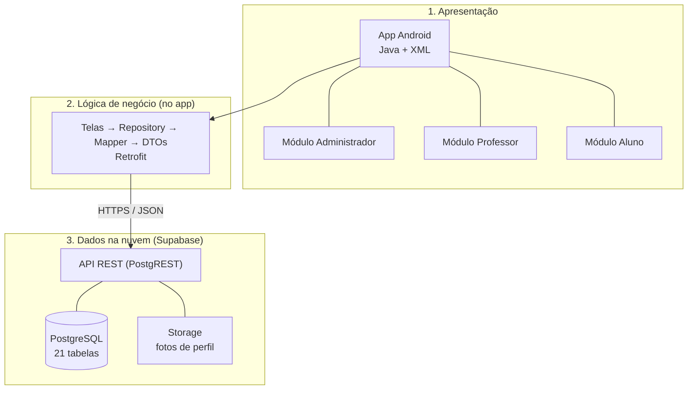
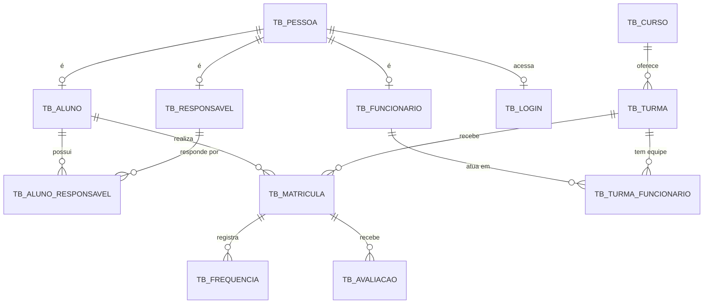

# SisGESC – ERP de Gestão Educacional

Sistema de gestão escolar para a **Escola Banda Alana**, que oferece educação musical gratuita para crianças e adolescentes. O SisGESC centraliza alunos, responsáveis, funcionários, cursos, turmas, matrículas e frequência em um único aplicativo Android. Os dados ficam em um banco **PostgreSQL na nuvem, hospedado no Supabase**, então o app funciona em qualquer aparelho com internet, sem precisar instalar servidor ou banco local.

[](https://www.java.com)
[](https://developer.android.com)
[](https://supabase.com)
[](https://www.postgresql.org)

<p align="center">
  
  
  
  
</p>

---

## Sobre o projeto

A Escola Banda Alana acompanhava seus alunos por meio de planilhas, Google Drive, papel e WhatsApp. Isso gerava erros, retrabalho e dificuldade para consultar os dados.

O SisGESC resolve esse problema reunindo tudo em um ambiente seguro e organizado:

- **Centralização:** alunos, turmas, matrículas e frequência em um só lugar
- **Menos retrabalho:** fim dos processos manuais e repetitivos
- **Acesso rápido:** consulta imediata para coordenação, equipe e gestão
- **Controle:** visão unificada de turmas, cursos, alunos e histórico

O sistema tem três perfis de acesso:

| Perfil | O que faz |
|--------|-----------|
| **Administrador / Gestor** | Cadastra e gerencia alunos, funcionários, cursos e turmas; acompanha indicadores e frequência |
| **Professor / Monitor** | Vê suas turmas, consulta alunos (somente leitura) e faz a chamada |
| **Aluno / Responsável** | Consulta dados, turma, aulas, avisos e histórico de presença, e atualiza seus dados de contato |

## Telas do app

**Acesso (todos os perfis)**

<p>
  
  
  
  
  
  
  
</p>

**Administrador / Gestor**

<p>
  
</p>

**Professor / Monitor**

<p>
  
  
  
  
  
</p>

**Aluno / Responsável**

<p>
  
  
  
  
</p>

## Funcionalidades

- [x] Login por perfil (Aluno/Responsável, Professor/Monitor e Gestor/Administrador)
- [x] Cadastro, consulta, alteração e exclusão de alunos, funcionários, cursos e turmas
- [x] Chamada com presença/ausência e observação opcional por aluno
- [x] Consulta de frequência e histórico de aulas pelo aluno/responsável
- [x] Avisos da coordenação exibidos no dashboard do aluno
- [x] Atualização de dados pessoais e de contato
- [x] Recuperação de senha
- [x] Controle de acesso por perfil (cada usuário só vê o que é da sua função)

## Casos de uso

| Ator | Casos de uso |
|------|--------------|
| **Responsável** | Consultar dados, atualizar dados, consultar aulas, consultar presença |
| **Administrador** | Manter aluno, manter funcionário, manter curso, manter turma |
| **Monitor Professor** | Consultar dados, fazer chamada |
| **Monitor Auxiliar** | Consultar dados |

## Regras de negócio

| Código | Regra |
|--------|-------|
| RN01 | Todo aluno, responsável ou funcionário possui um registro único em `tb_pessoa`, com o **CPF** como chave primária |
| RN02 | O aluno só pode ser matriculado em turma cuja faixa etária (`idade_min` e `idade_max`) inclua a sua idade |
| RN03 | Cada aluno pode estar matriculado em no máximo **2 cursos** ao mesmo tempo |
| RN04 | **2 faltas não justificadas** disparam alerta administrativo e o aluno fica sujeito à perda da vaga após análise pedagógica |
| RN05 | Toda turma deve ter no mínimo **1 monitor ou professor** associado |
| RN06 | Todo aluno menor de idade deve ter ao menos **1 responsável legal** vinculado (`tb_aluno_responsavel`) |

## Arquitetura

O SisGESC é dividido em três camadas. O app Android conversa diretamente com o **Supabase**, que expõe o banco PostgreSQL na nuvem por uma API REST.



- **Apresentação:** app Android em Java e XML, com três módulos (Administrador, Professor e Aluno).
- **Lógica de negócio:** dentro do app, cada módulo tem *Repository* (regras e acesso aos dados), *Mapper* (converte as respostas do banco) e *DTOs* (dados que as telas mostram). As chamadas HTTP são feitas com **Retrofit**.
- **Dados:** **Supabase**, que fornece o banco **PostgreSQL na nuvem** (tabelas `tb_*`), a API REST para acessá-lo e o *Storage* para as fotos de perfil.

## Tecnologias

- **App:** Java, XML Layouts, Android Studio, Retrofit
- **Banco de dados:** PostgreSQL na nuvem, hospedado no **Supabase** (API REST e Storage de fotos)
- **Integrações:** API de CEP para preencher endereços
- **Modelagem:** UML, DER (modelo conceitual, lógico e físico), dbdiagram.io
- **Distribuição:** instalação direta do APK (sem publicação na Play Store)

## Banco de dados

O banco é **PostgreSQL**, hospedado na nuvem pelo **Supabase**. Ele tem **21 tabelas** organizadas em módulos:

| Módulo | Tabelas |
|--------|---------|
| **Pessoa** | `tb_pessoa`, `tb_telefone`, `tb_cep`, `tb_endereco`, `tb_email` |
| **Aluno e Responsável** | `tb_aluno`, `tb_responsavel`, `tb_aluno_responsavel` |
| **Funcionários** | `tb_funcionario`, `tb_tipo_monitor`, `tb_cargo`, `tb_funcionario_cargo`, `tb_aviso` |
| **Curso e Turma** | `tb_curso`, `tb_turma`, `tb_matricula`, `tb_turma_funcionario` |
| **Frequência e Avaliação** | `tb_frequencia`, `tb_avaliacao` |
| **Autorização de Imagem** | `tb_autorizacao_imagem` |
| **Login** | `tb_login` |

Resumo dos relacionamentos principais:



Modelo lógico completo: [dbdiagram.io](https://dbdiagram.io/d/BandaAlana_DER_OFICIAL-6aefb5f1f1d298b5739d4a77)

## Como rodar

Existem duas formas de executar o app: instalando o APK ou abrindo o projeto no Android Studio.

> **Não é preciso instalar banco de dados nem servidor.** O PostgreSQL está na nuvem (Supabase), então basta o aparelho ou o emulador ter **conexão com a internet**.

### Opção 1: instalar o APK

1. Baixe o arquivo `.apk` do projeto no celular Android.
2. Abra o arquivo. O Android vai pedir permissão para **instalar apps de fontes desconhecidas**, então autorize.
3. Conclua a instalação e abra o app **SisGESC**.

### Opção 2: abrir pelo Android Studio

**Pré-requisitos**

- [Android Studio](https://developer.android.com/studio) instalado
- JDK 17 ou 21 (o Android Studio já traz um JDK embutido)

**Passos**

1. Clone o repositório:

   ```bash
   git clone https://github.com/SEU_USUARIO/NOME_DO_REPOSITORIO.git
   ```

2. No Android Studio, vá em **File → Open** e selecione a pasta do projeto.
3. Aguarde o Gradle sincronizar as dependências.
4. Escolha onde executar o app:

   - **Emulador do Android Studio:** em **Device Manager**, crie ou selecione um dispositivo virtual.
   - **Celular Android:** ative as **Opções do desenvolvedor** e a **Depuração USB** no aparelho, conecte-o ao computador por cabo USB e autorize a conexão.

5. Clique em **Run ▶** para instalar e abrir o app.

## Fora do escopo

Por ser uma instituição de aulas **100% gratuitas**, o app **não terá**:

- Módulos financeiros (boletos, PIX, cartão, controle de caixa)
- Loja virtual ou venda de produtos e serviços
- Mensalidades, taxas de matrícula ou cobranças

## Segurança e LGPD

- Tratamento seguro de dados sensíveis de menores, responsáveis e autorizações de imagem (Lei nº 13.709/2018)
- Senhas armazenadas como **hash** (`senha_hash`)
- Controle de acesso por perfil (RBAC) e autenticação de usuários
- Banco PostgreSQL hospedado na nuvem (Supabase)
- Integridade referencial com chaves estrangeiras
- Backups periódicos do banco de dados

## Documentação

O documento completo do projeto (visão, casos de uso, requisitos, diagramas UML e DER, modelo físico, arquitetura, glossário e protótipos de interface) está em [`docs/`](docs).

## Equipe

| Função | Integrantes |
|--------|-------------|
| **Líder** | Madelayne Mendoza Huanca |
| **Analistas** | Izabel Linhares dos Santos, Vinicius Pereira de Oliveira |
| **Desenvolvedores** | Lucas Fonseca Shiraoka, Izabel Linhares dos Santos, Hanan Ibrahim El Khatib Sleiman, Beatriz Morais |
| **Testadores** | Rebeca Vieira de Souza, Kauan Marques Turra |
| **Projetistas de BD** | Laura Cristine Silva, Izabel Linhares dos Santos, Geovanna Silva Laurentino, Madelayne Mendoza Huanca |
| **Documentadoras** | Geovanna Silva Laurentino, Júlia Fidelis de Santana |

Projeto desenvolvido no curso de **Análise e Desenvolvimento de Sistemas** da **Universidade Cidade de São Paulo (UNICID)**, sob orientação do professor **Jadir Custodio Mendonça Junior**.

